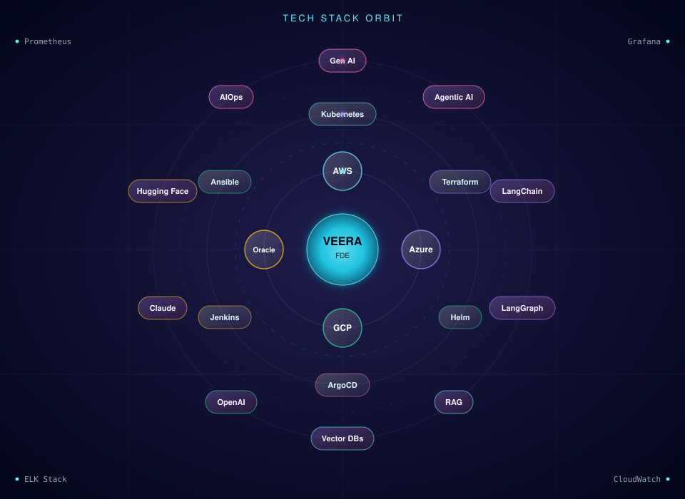
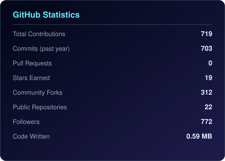
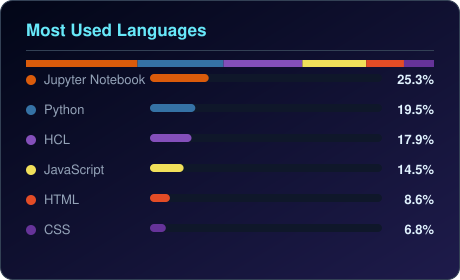

<div align="center">



<br/><br/>

<a href="http://veera.veeraopstech.online/"></a>
<a href="https://cloudinit.online"></a>
<a href="https://www.linkedin.com/in/veerababu-narni-b99b05256"></a>
<a href="https://medium.com/@veerababu.narni232"></a>
<a href="mailto:veeraopstechnologies@gmail.com"></a>
<a href="https://github.com/CloudTechDevOps?tab=followers"></a>
<a href="https://github.com/CloudTechDevOps"></a>

</div>

<br/>

## 🪟 About

<table>
<tr>
<td valign="top" width="55%">

**Cloud DevOps &amp; AI Forward Deployed Engineer** with **15+ years** across **AWS, Azure, GCP and Oracle Cloud**. I design and operate production infrastructure for enterprise workloads, lead DevOps transformations, and build the CI/CD that carries mission-critical systems.

As a **Forward Deployed Engineer** I embed with customer teams to take **Generative AI and Agentic AI** from prototype to production: RAG systems grounded in real enterprise data, tool-using agents wired into cloud and DevOps platforms, and the guardrails, evals and observability that make them safe to run.

I've trained **30K+ students** through **30+ real projects**, from first principles to placement-ready. Everything I teach is something I run in production.


</td>
<td valign="top" width="45%">

```yaml
whoami:
  name:         Veerababu Narni
  role:         Cloud DevOps & AI Forward Deployed Engineer
  experience:   15+ years
  clouds:       [AWS, Azure, GCP, Oracle Cloud]
  core:         [Kubernetes, Terraform, Ansible, CI/CD, Observability]
  gen_ai:       [LLM apps, RAG, prompt & context eng, fine-tuning, evals]
  agentic_ai:   [multi-agent, tool use, MCP, human-in-the-loop]
  ai_platforms: [Bedrock, Azure OpenAI, Vertex AI, Claude, OpenAI]
  fde:          [discover, prototype, productionise, deploy, enable]
  students_trained: 30K+
  real_projects:    30+
```

</td>
</tr>
</table>

> [!TIP]
> **Everything here is meant to run.** Real Terraform that plans, real manifests that apply, real pipelines that execute — not snippets pasted from slide decks. Clone any repository and follow its README.

<br/>

## 📊 By the Numbers

<div align="center">



<table>
<tr>
<td align="center" width="140"><b><!--STAT:FOLLOWERS-->765<!--/STAT:FOLLOWERS--></b><br/><sub>Followers</sub></td>
<td align="center" width="140"><b><!--STAT:REPOS-->15<!--/STAT:REPOS--></b><br/><sub>Public Repositories</sub></td>
<td align="center" width="140"><b><!--STAT:FORKS-->235<!--/STAT:FORKS--></b><br/><sub>Community Forks</sub></td>
<td align="center" width="140"><b><!--STAT:STARS-->13<!--/STAT:STARS--></b><br/><sub>Stars Earned</sub></td>
</tr>
</table>

<!-- stats last updated: 2026-11-06 -->

</div>

<br/>


## 🧩 Three Pillars

<table>
<tr>
<td valign="top" width="33%">

### 🤖 Generative AI
LLM apps that are versioned, tested, observable and cost-controlled.

- RAG over enterprise data
- Prompt &amp; context engineering
- Fine-tuning &amp; open models
- Evals, guardrails, LLMOps

</td>
<td valign="top" width="33%">

### 🧠 Agentic AI
Agents that plan, call tools and operate infrastructure — and ask before they act.

- Multi-agent orchestration
- MCP tool servers
- AIOps &amp; self-healing
- Human-in-the-loop safety

</td>
<td valign="top" width="34%">

### 🛰️ Forward Deployed
Embedded with your team, from use case to a system running in your cloud.

- Discovery &amp; success metrics
- Prototype on real data in days
- Production on AWS / Azure / GCP
- Enablement &amp; hand-over

</td>
</tr>
</table>

<br/>

## 🤖 Generative AI



<details>
<summary><b>What I build</b></summary>

<br/>

| Area | What I Build |
|---|---|
| **LLM App Architecture** | Chat assistants, copilots and document-intelligence apps on Amazon Bedrock, Azure OpenAI, Vertex AI, Claude and OpenAI |
| **RAG Pipelines** | Ingestion, chunking, embeddings, hybrid search and re-ranking to ground answers in enterprise data |
| **Prompt &amp; Context Engineering** | Structured prompts, long-context design, output schemas and prompt versioning |
| **Fine-Tuning &amp; Open Models** | LoRA/PEFT fine-tuning, Hugging Face models, self-hosted serving with vLLM and Ollama |
| **Evaluation &amp; Guardrails** | Golden datasets, LLM-as-judge evals, hallucination checks, PII redaction and content filters |
| **LLMOps** | Model serving on Kubernetes, tracing, token-cost dashboards, caching and latency budgets |

</details>

<br/>

## 🧠 Agentic AI



<details>
<summary><b>What I build</b></summary>

<br/>

| Area | What I Build |
|---|---|
| **Agent Orchestration** | Single and multi-agent workflows with LangGraph, CrewAI and AutoGen-style patterns |
| **Tool Use &amp; MCP** | Model Context Protocol servers exposing cloud APIs, Kubernetes, Terraform and CI/CD as scoped agent tools |
| **AIOps Agents** | Log and alert triage, root-cause analysis, runbook execution and self-healing pipelines |
| **Memory &amp; Retrieval** | Vector databases (Pinecone, pgvector, OpenSearch) and state stores for long-running agents |
| **Safety &amp; Control** | Least-privilege tool permissions, human-in-the-loop approvals, audit trails and rollback paths |
| **Agent Observability** | Step-level traces, task-success evals, cost per run and failure analysis |

</details>

<br/>

## 🛰️ Forward Deployed Engineering



<details>
<summary><b>How an engagement runs</b></summary>

<br/>

| Phase | What Happens |
|---|---|
| **1 · Discover** | Sit with stakeholders, map the workflow, define success metrics and data access |
| **2 · Prototype** | Ship a working Gen AI / agent prototype on real data within days, not quarters |
| **3 · Productionise** | Terraform-provisioned infrastructure, CI/CD, security review, evals and guardrails |
| **4 · Deploy &amp; Operate** | Roll out on the customer's own AWS, Azure or GCP account with observability and cost controls |
| **5 · Enable &amp; Hand Over** | Documentation, runbooks and hands-on training so the team owns it afterwards |

**FDE toolkit:** full-stack delivery (Python / Node.js APIs and lightweight UIs) · cloud-native by default (containers, Kubernetes, serverless, IaC) · enterprise integration (SSO, IAM, private networking, data connectors, compliance) · translating between business outcomes and engineering decisions.

</details>

<br/>


## 🎯 Current Focus

- 🛰️ **Forward deploying** Gen AI solutions with customer teams — from use-case discovery to production rollout on their own cloud
- 🤖 **Building** agentic AI workflows for DevOps — LLM-driven incident response, autonomous remediation agents and RAG-based infra assistants
- 🔌 **Exploring** the Model Context Protocol (MCP) to give agents safe, scoped access to cloud APIs, Kubernetes and CI/CD
- 🏗️ **Architecting** multi-cloud disaster recovery for a critical enterprise application
- 🔍 **Researching** service mesh (Istio) and advanced FinOps for cloud cost governance

<details>
<summary><b>🤝 What I'm useful for</b></summary>

<br/>

- **Generative AI delivery** — RAG assistants, document intelligence and copilots on Bedrock, Azure OpenAI and Vertex AI
- **Agentic AI for operations** — LLM-driven incident response, autonomous remediation, RAG over infrastructure data
- **Forward deployed engineering** — embedding with your team to turn an AI use case into a production-grade system
- **LLMOps &amp; AI governance** — evaluation pipelines, guardrails, cost and latency controls, audit-ready deployments
- **Multi-cloud architecture reviews** — AWS, Azure and GCP landing zones, hybrid governance, DR strategy
- **Kubernetes and GitOps** — EKS/AKS/GKE design, Helm, ArgoCD, progressive delivery
- **Infrastructure as Code** — Terraform module design, remote state, drift control
- **Cloud cost optimisation** — rightsizing, commitment planning, waste elimination

</details>

<details>
<summary><b>🧭 How I work</b></summary>

<br/>

| Principle | In practice |
|---|---|
| **Build it before teaching it** | Every module ships from a deployment I have actually operated |
| **Infrastructure as code, always** | No console clicking that cannot be reproduced from a repository |
| **Cost is a design constraint** | FinOps considered at architecture time, not after the invoice |
| **Observability first** | If it cannot be measured, it is not finished |
| **Least privilege by default** | IAM scoped narrowly — for engineers and for AI agents |
| **Humans approve what matters** | Agents propose, people approve anything irreversible |

</details>

<br/>

## 🛠️ Technology Stack

<div align="center">

</div>

<br/>

<table>
<tr>
<td valign="top" width="50%">

**☁️ Cloud Platforms**


**⚙️ DevOps &amp; Orchestration**


**📈 Monitoring &amp; Observability**


</td>
<td valign="top" width="50%">

**💻 Programming &amp; Scripting**


**🗄️ Databases &amp; Caching**


**🤖 Generative &amp; Agentic AI**


</td>
</tr>
</table>

<br/>

## 🧭 Areas of Specialisation

| Area | Focus |
|---|---|
| **Project-Based Learning** | Every module built around real deployments, not slide decks |
| **Enterprise Cloud Architecture** | Production-grade infrastructure design across AWS, Azure, and GCP |
| **Kubernetes &amp; Containers** | Docker, EKS, AKS, GKE, Helm, ArgoCD, and full GitOps workflows |
| **Infrastructure as Code** | Terraform, Ansible, OpenTofu — end-to-end automation |
| **AI &amp; ML for DevOps** | KubeGPT, GitHub Copilot, AIOps, LLM-powered pipelines |
| **Generative AI** | LLM app architecture, RAG pipelines, document intelligence, fine-tuning, evals |
| **Agentic AI** | Tool-using and multi-agent systems, MCP integrations, human-in-the-loop approvals |
| **Forward Deployed Engineering** | Customer-embedded delivery of AI and cloud solutions, from discovery to production |
| **LLMOps** | Model serving on Kubernetes, guardrails, tracing, cost and latency governance |
| **Cloud Security** | IAM, SSO, VPC hardening, zero-trust, and compliance architecture |
| **Observability** | Prometheus, Grafana, ELK Stack, CloudWatch — full-stack alerting |
| **Multi-Cloud Strategy** | Cost optimisation, cloud-native migration, hybrid governance |
| **Career Placement** | Engineers placed at Amazon, Microsoft, TCS, Infosys, Wipro, and startups |

<br/>


## 🚀 Featured Repositories

Real, runnable repositories from this account — ordered by how much the community actually uses them.

| Repository | What It Is | Stack | Forks |
|---|---|---|:--:|
| **[Linux-commands](https://github.com/CloudTechDevOps/Linux-commands)** | Practical Linux command reference for DevOps engineers — the most forked repo here | `Linux` `Bash` | 110 |
| **[aws-ecomerce-Application-Multiple-services](https://github.com/CloudTechDevOps/aws-ecomerce-Application-Multiple-services)** | Multi-storefront e-commerce app: Flask API + 9 static frontends, with architecture and flow diagrams | `Python` `Flask` `AWS` `Nginx` | 29 |
| **[veera-ops](https://github.com/CloudTechDevOps/veera-ops)** | Training portfolio site, containerised and shipped via Azure Pipelines to a custom domain | `HTML` `Docker` `Azure Pipelines` | 26 |
| **[Kubernetes-0900](https://github.com/CloudTechDevOps/Kubernetes-0900)** | 19-day hands-on EKS course: pods to RBAC, HPA, VPC-CNI, StatefulSets, Helm, ArgoCD, IRSA | `Kubernetes` `Helm` `EKS` | 24 |
| **[Kubernetes-1030](https://github.com/CloudTechDevOps/Kubernetes-1030)** | Parallel Kubernetes track — services, autoscaling, ArgoCD, path-based ingress, Helm charts | `Kubernetes` `Helm` `ArgoCD` | 20 |
| **[python-backend-testing](https://github.com/CloudTechDevOps/python-backend-testing)** | Six Flask backend variants compared: plain, read-replica, Secrets Manager, ElastiCache, Nginx LB | `Python` `Flask` `RDS` `Redis` | 18 |
| **[lambda-](https://github.com/CloudTechDevOps/lambda-)** | Library of standalone AWS Lambda handlers: EC2, S3, RDS, CloudFront, CloudWatch log export | `Python` `boto3` `Lambda` | 18 |
| **[Azure-app-service-deployment](https://github.com/CloudTechDevOps/Azure-app-service-deployment)** | Flask app deployed to Azure App Service through GitHub Actions | `Python` `Azure` `Actions` | 15 |
| **[Azure-3-tier-terraform-deployment](https://github.com/CloudTechDevOps/Azure-3-tier-terraform-deployment)** | Modular 3-tier Azure architecture in Terraform — bastion, frontend/backend VM + VMSS, LBs, database | `Terraform` `Azure` | 13 |
| **[azure-funation-app](https://github.com/CloudTechDevOps/azure-funation-app)** | Azure Functions Python **v1** model — `function.json` bindings per function folder | `Python` `Azure Functions` | 12 |
| **[2nd10WeeksofCloudOps-main](https://github.com/CloudTechDevOps/2nd10WeeksofCloudOps-main)** | Full-stack bookstore: React client + Node/Express API + MySQL, with Terraform EKS modules, K8s manifests and Jenkins pipelines | `React` `Node` `Terraform` `EKS` | 11 |
| **[azure-function](https://github.com/CloudTechDevOps/azure-function)** | Azure Functions Python **v2** model — decorator-based `function_app.py`, deployed by Actions | `Python` `Azure Functions` | 11 |
| **[gcp-iam](https://github.com/CloudTechDevOps/gcp-iam)** | GCP IAM reference: resource hierarchy, roles, bindings, service accounts, least privilege | `GCP` `IAM` | 7 |
| **[Terraform0730](https://github.com/CloudTechDevOps/Terraform0730)** | Day-by-day Terraform curriculum on AWS — providers, custom VPC, remote state + locking, RDS, lifecycle, root/child modules | `Terraform` `AWS` | 6 |
| **[GCP-Terraform](https://github.com/CloudTechDevOps/GCP-Terraform)** | Terraform on GCP, including a static site bucket deployment | `Terraform` `GCP` | 5 |
| **[sample_nodejs_on_Ec2](https://github.com/CloudTechDevOps/sample_nodejs_on_Ec2)** | Minimal Node.js service containerised for EC2 deployment | `Node.js` `Docker` `EC2` | 5 |
| **[docker_python_flask-project](https://github.com/CloudTechDevOps/docker_python_flask-project)** | Dockerised Flask app with multiple Azure Web App deployment workflows plus EC2/Nginx notes | `Python` `Docker` `Azure` | 4 |
| **[gcp-cloud-run-funation-deployment](https://github.com/CloudTechDevOps/gcp-cloud-run-funation-deployment)** | Containerised Flask service deployed to Google Cloud Run | `Python` `Cloud Run` | 4 |
| **[onlinebookstore](https://github.com/CloudTechDevOps/onlinebookstore)** | Java JSP/Servlet bookstore (fork) wired up with Jenkins, CodeBuild and CodeDeploy | `Java` `Maven` `Tomcat` | 7 |
| **[git-branch](https://github.com/CloudTechDevOps/git-branch)** | Sandbox for practising git branching and pull-request workflow | `Python` `Git` | 0 |

<br/>

## 📈 GitHub Analytics

<div align="center">




<br/><br/>


<br/><br/>


<br/><br/>

<picture>
  <source media="(prefers-color-scheme: dark)" srcset="https://raw.githubusercontent.com/CloudTechDevOps/CloudTechDevOps/output/github-snake-dark.svg" />
  <source media="(prefers-color-scheme: light)" srcset="https://raw.githubusercontent.com/CloudTechDevOps/CloudTechDevOps/output/github-snake.svg" />
  
</picture>

</div>

<br/>


## 🏅 Certifications

<div align="center">
<table>
  <tr>
    <td align="center" width="200">
      <a href="https://www.credly.com/badges/ff07c2a6-a093-44fd-acc7-8534995f2dca"></a>
      <br/><b>AWS Solutions Architect</b><br/><sub>Amazon Web Services · Professional</sub>
      <br/><sub>✅ <a href="https://www.credly.com/badges/ff07c2a6-a093-44fd-acc7-8534995f2dca">Verify</a></sub>
    </td>
    <td align="center" width="200">
      <a href="https://www.credly.com/badges/afe77f2b-843a-413c-925d-4c8ea7891503"></a>
      <br/><b>Kubernetes Administrator (CKA)</b><br/><sub>Linux Foundation / CNCF</sub>
      <br/><sub>✅ <a href="https://www.credly.com/badges/afe77f2b-843a-413c-925d-4c8ea7891503">Verify</a></sub>
    </td>
    <td align="center" width="200">
      
      <br/><b>Azure DevOps Engineer Expert</b><br/><sub>Microsoft Azure</sub>
    </td>
    <td align="center" width="200">
      
      <br/><b>Terraform Associate</b><br/><sub>HashiCorp</sub>
    </td>
  </tr>
  <tr>
    <td align="center" width="200">
      
      <br/><b>AWS DevOps Engineer</b><br/><sub>Amazon Web Services · Professional</sub>
    </td>
    <td align="center" width="200">
      
      <br/><b>Kubernetes App Developer (CKAD)</b><br/><sub>Linux Foundation / CNCF</sub>
    </td>
    <td align="center" width="200">
      
      <br/><b>GCP Professional DevOps Engineer</b><br/><sub>Google Cloud</sub>
    </td>
    <td align="center" width="200">
      
      <br/><b>Docker Certified Associate</b><br/><sub>Docker Inc.</sub>
    </td>
  </tr>
</table>
</div>

<br/>

## ✍️ Latest Writing

<!--WRITING:START-->
- [How to Deploy a Self-Hosted Agent in Azure Pipeline](https://medium.com/@veerababu.narni232/how-to-deploy-a-self-hosted-agent-in-azure-pipeline-c07a4f4ca4c4) <sub>· Jul 2025</sub>
- [Querying Data in S3 with Amazon Athena](https://medium.com/@veerababu.narni232/querying-data-in-s3-with-amazon-athena-d9319eb87155) <sub>· Jun 2025</sub>
- [How to Create and Connect to a Linux Virtual Machine Scale Set (VMSS) on Azure](https://medium.com/@veerababu.narni232/how-to-create-and-connect-to-a-linux-virtual-machine-scale-set-vmss-on-azure-f7c380cb49bd) <sub>· Jun 2025</sub>
- [Azure Interview Questi](https://medium.com/@veerababu.narni232/azure-interview-questi-273ca5acbcdc) <sub>· Jun 2025</sub>
- [Azure Load Balancer: An Introduction](https://medium.com/@veerababu.narni232/azure-load-balancer-an-introduction-8aa0b15c6935) <sub>· Jun 2025</sub>
<!--WRITING:END-->

<br/>

## 🎯 2026 Goals

- 🤖 Ship a production agentic-AI framework for autonomous cloud operations
- 🧠 Publish open, runnable Gen AI and Agentic AI repositories — RAG, MCP servers and DevOps agents — with full Terraform deployments
- 🛰️ Launch a Forward Deployed Engineer track for engineers moving from DevOps into customer-facing AI delivery
- 🌱 Contribute to five or more significant open-source DevOps tools
- 📝 Publish six or more in-depth articles on multi-cloud architecture, FinOps and AI in production
- 📚 Bring every repository in this account to production-grade documentation

<br/>

## 🤝 Open Source &amp; Collaboration

- **DevOps Tooling** — pull requests for performance enhancements and bug fixes
- **Cloud-Native Projects** — feature development for multi-cloud compatibility
- **Infrastructure-as-Code Modules** — maintenance of reusable Terraform modules for AWS resources
- **Teaching Repositories** — the course repos above are open to issues and PRs; corrections welcome

<br/>

<div align="center">



<br/><br/>

<a href="https://www.linkedin.com/in/veerababu-narni-b99b05256"></a>
<a href="https://medium.com/@veerababu.narni232"></a>
<a href="mailto:veeraopstechnologies@gmail.com"></a>
<a href="http://veera.veeraopstech.online/"></a>

<br/>

<sub>Profile graphics are generated by <code>scripts/</code> and refreshed by GitHub Actions — stats, motion assets, contribution snake and latest writing.</sub>

</div>
